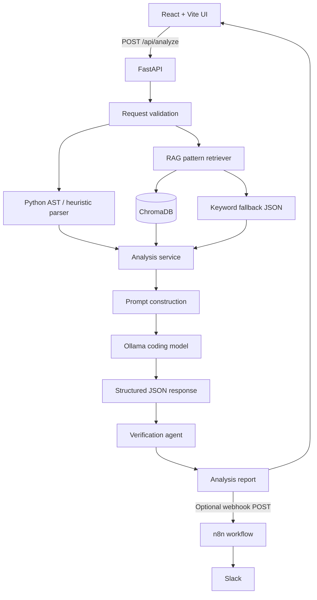

# Code Snippet Explainer

CodeWise AI is a full-stack AI-assisted code analysis application. Paste a source-code snippet, choose its language and explanation depth, and receive a structured engineering report covering what the code does, how it is organized, possible issues, complexity assumptions, improvement suggestions, and test ideas.

The application combines deterministic Python source inspection, retrieval-augmented coding guidance (RAG), a locally hosted Ollama coding model, a lightweight verification agent, and optional n8n-to-Slack report delivery.

> **Important:** CodeWise AI analyzes source text; it does not execute submitted code. Its verification checks are limited consistency checks, not formal verification, a complete static analyzer, a security audit, or runtime testing.

## Table of contents

- [Features](#features)
- [Technology stack](#technology-stack)
- [How it works](#how-it-works)
- [Architecture](#architecture)
- [Repository structure](#repository-structure)
- [Prerequisites](#prerequisites)
- [Installation](#installation)
- [Run the application](#run-the-application)
- [Use the application](#use-the-application)
- [API reference](#api-reference)
- [n8n and Slack integration](#n8n-and-slack-integration)
- [Run tests](#run-tests)
- [Configuration](#configuration)
- [Language support and limitations](#language-support-and-limitations)
- [Troubleshooting](#troubleshooting)
- [Security notes](#security-notes)
- [Learning outcomes](#learning-outcomes)

## Features

- Paste source code into a browser-based editor.
- Select Python, JavaScript, TypeScript, Java, C, C++, C#, Go, or SQL as the declared language.
- Choose concise, detailed, or deep explanation depth.
- Generate a structured report with:
  1. Code overview
  2. Step-by-step walkthrough
  3. Code structure
  4. Programming concepts
  5. Inputs, processing, outputs, and side effects
  6. Time and space complexity estimates with assumptions
  7. Issues and risks
  8. A recommended improvement and suggested rewrite
  9. Suggested test cases
  10. Agent verification results
- Extract Python functions, classes, imports, variables, control-flow constructs, docstrings, returns, raises, and async usage with Python's AST.
- Use heuristic pattern extraction for selected non-Python languages.
- Retrieve coding guidance from ChromaDB using Sentence Transformers embeddings.
- Fall back to keyword-based retrieval if ChromaDB cannot be initialized.
- Generate structured JSON analysis using Ollama.
- Check proposed Python rewrite syntax and flag certain unsupported execution claims.
- Optionally forward the report to an n8n webhook for Slack delivery.
- Check backend and Ollama status through the health endpoint.

## Technology stack

| Layer | Technologies |
|---|---|
| Frontend | React 18, Vite, JavaScript, CSS |
| Backend/API | Python, FastAPI, Pydantic, Uvicorn |
| LLM | Ollama; default model `qwen2.5-coder:7b` |
| Source inspection | Python `ast` module |
| RAG/vector retrieval | ChromaDB, Sentence Transformers |
| Embeddings | `all-MiniLM-L6-v2` |
| Automation | n8n Webhook, Slack node |
| HTTP integration | Python `urllib`, browser Fetch API |
| Testing | pytest, HTTPX |

## How it works

1. The user enters code, selects a language, chooses an explanation depth, and optionally enables Slack delivery.
2. React sends a JSON request to `POST /api/analyze`.
3. The backend validates the request with the Pydantic `AnalyzeRequest` model.
4. `code_parser.py` extracts structural facts. Python uses `ast.parse`; supported non-Python languages use deliberately heuristic pattern matching.
5. `rag_service.py` retrieves coding guidance from ChromaDB. If vector retrieval is unavailable, it attempts keyword-based retrieval from `backend/app/data/code_patterns.json`.
6. `llm_service.py` builds a constrained prompt and sends it to the locally running Ollama chat API, requesting JSON output.
7. `analysis_service.py` normalizes the response, adds parser facts and retrieval metadata, and invokes the verification checks.
8. The API returns the structured report to the React UI.
9. If Slack delivery was selected, the backend sends the code and report to the configured n8n webhook.

## Architecture



## Repository structure

```text
CodeWise_AI/
├── README.md
├── .gitignore
├── backend/
│   ├── app/
│   │   ├── main.py
│   │   ├── models.py
│   │   ├── config.py
│   │   ├── data/
│   │   │   └── code_patterns.json
│   │   └── services/
│   │       ├── code_parser.py
│   │       ├── rag_service.py
│   │       ├── llm_service.py
│   │       ├── agent_service.py
│   │       └── analysis_service.py
│   ├── tests/
│   │   ├── test_parser.py
│   │   └── test_agent.py
│   ├── .env.example
│   └── requirements.txt
├── frontend/
│   ├── src/
│   │   ├── components/
│   │   │   ├── CodeEditor.jsx
│   │   │   └── AnalysisResult.jsx
│   │   ├── services/
│   │   │   └── api.js
│   │   ├── App.jsx
│   │   ├── App.css
│   │   └── main.jsx
│   ├── .env.example
│   ├── package.json
│   └── vite.config.js
└── n8n/
    └── slack_workflow.json
```

The `backend/app/data/code_patterns.json` file is required for the keyword retrieval fallback and for seeding a new ChromaDB collection. Make sure it is included in the repository.

## Prerequisites

Install:

- Python 3.10 or later.
- Node.js 18 or later and npm.
- Git.
- Ollama.
- The configured Ollama model: `qwen2.5-coder:7b`.

The first ChromaDB initialization may download the Sentence Transformers embedding model. Internet access is required for the initial model download unless it is already cached.

### Install Ollama and download the model

Download Ollama from [https://ollama.com/](https://ollama.com/).

In a terminal, run:

```bash
ollama pull qwen2.5-coder:7b
```

Check that it is installed:

```bash
ollama list
```

Ollama normally exposes its local API at `http://localhost:11434`.

## Installation

### 1. Clone the repository

```bash
git clone https://github.com/<your-github-username>/<your-repository-name>.git
cd <your-repository-name>
```

Replace the placeholders with your GitHub username and repository name.

### 2. Set up the backend

From the repository root:

**Windows PowerShell**

```powershell
cd backend
py -3.11 -m venv .venv
.\.venv\Scripts\Activate.ps1
python -m pip install --upgrade pip
pip install -r requirements.txt
Copy-Item .env.example .env
```

If PowerShell blocks activation, run this in the same PowerShell session and activate again:

```powershell
Set-ExecutionPolicy -Scope Process -ExecutionPolicy Bypass
```

**macOS / Linux**

```bash
cd backend
python3 -m venv .venv
source .venv/bin/activate
python -m pip install --upgrade pip
pip install -r requirements.txt
cp .env.example .env
```

Open `backend/.env` and check the values:

```env
OLLAMA_BASE_URL=http://localhost:11434
OLLAMA_MODEL=qwen2.5-coder:7b
CHROMA_PATH=./data/chroma_db
N8N_WEBHOOK_URL=
REQUEST_TIMEOUT=180
```

`N8N_WEBHOOK_URL` is optional. Leave it empty if you do not plan to send reports through n8n.

### 3. Set up the frontend

Open a **second terminal** at the repository root.

**Windows PowerShell**

```powershell
cd frontend
npm install
Copy-Item .env.example .env
```

**macOS / Linux**

```bash
cd frontend
npm install
cp .env.example .env
```

The frontend environment file should contain:

```env
VITE_API_BASE_URL=http://127.0.0.1:8000
```

## Run the application

Run Ollama, the FastAPI backend, and the Vite frontend.

### Terminal 1 — Ollama

Ensure Ollama is running. If it is not running as a background service, start it with:

```bash
ollama serve
```

Confirm that the model is available:

```bash
ollama list
```

### Terminal 2 — FastAPI backend

From the repository root:

```powershell
cd backend
.\.venv\Scripts\Activate.ps1
uvicorn app.main:app --reload --host 127.0.0.1 --port 8000
```

On macOS/Linux, activate the environment with:

```bash
source .venv/bin/activate
```


Backend URLs:

- Health: [http://127.0.0.1:8000/api/health](http://127.0.0.1:8000/api/health)
- Swagger API documentation: [http://127.0.0.1:8000/docs](http://127.0.0.1:8000/docs)

### Terminal 3 — React frontend

From the repository root:

```powershell
cd frontend
npm run dev
```

Open the Vite URL, normally:

[http://localhost:5173](http://localhost:5173)

To create a production frontend build:

```bash
npm run build
```

## Use the application

1. Open the frontend in your browser.
2. Paste a code snippet into the editor.
3. Select the language that matches the code.
4. Select an explanation depth: `Concise`, `Detailed`, or `Deep dive`.
5. Optionally enable **Send report to Slack via n8n** after configuring the webhook.
6. Click **Analyze code**.
7. Review the ten report sections.
8. Review the verification checks and warnings before using any suggested rewrite.

Example Python snippet:

```python
def calculate_total(prices):
    total = 0
    for price in prices:
        total += price
    return total
```

Example analysis request:

```json
{
  "code": "def add(a, b):\n    return a + b",
  "language": "python",
  "send_to_slack": false,
  "detail_level": "detailed"
}
```

## API reference

### `GET /api/health`

Checks the API and attempts to contact Ollama. The response includes:

- `status`
- `ollama_reachable`
- `model_available`
- `model`
- `retrieval`
- `n8n_configured`

### `POST /api/analyze`

Analyzes a source-code snippet.

Request body:

```json
{
  "code": "def add(a, b):\n    return a + b",
  "language": "python",
  "send_to_slack": false,
  "detail_level": "detailed"
}
```

Request fields:

| Field | Type | Description |
|---|---|---|
| `code` | string | Required source code; 1–30,000 characters |
| `language` | string | Declared language; defaults to `python` |
| `send_to_slack` | boolean | Whether to forward the report to n8n |
| `detail_level` | string | `concise`, `detailed`, or `deep` |

The response contains a structured report, including `summary`, `explanation`, `steps`, `code_structure`, `concepts`, `data_flow`, `inputs_outputs`, `complexity`, `issues`, `patterns_used`, `improvement`, `improved_code`, `test_cases`, `verification`, `retrieval`, `warnings`, and `slack_sent`.

### `POST /api/share`

Forwards a supplied report payload to the configured n8n webhook. The payload should contain the report under `analysis`; `code` may also be included.

## n8n and Slack integration

An importable workflow is included:

```text
n8n/slack_workflow.json
```

The workflow contains:

1. **Receive CodeWise Report** — receives a POST request through an n8n Webhook node.
2. **Format Slack Message** — prepares a concise report using a Code node.
3. **Post to Slack** — sends the formatted message to a selected Slack channel.

### Configure the workflow

1. Open your n8n instance.
2. Import `n8n/slack_workflow.json`.
3. Open the **Post to Slack** node.
4. Connect your Slack account using the n8n credential flow.
5. Replace `REPLACE_WITH_SLACK_CHANNEL_ID` with the intended Slack channel ID, or select the channel in the node.
6. Save the workflow.
7. Activate it when ready to use its production webhook URL.
8. Copy the webhook URL from the Webhook node.
9. Add that URL to `N8N_WEBHOOK_URL` in `backend/.env`.
10. Restart the FastAPI backend.
11. In CodeWise AI, enable **Send report to Slack via n8n** before analyzing a snippet.

The backend sends a POST body containing:

```json
{
  "event": "code_analysis_completed",
  "code": "source code submitted by the user",
  "analysis": {
    "summary": "Generated report summary"
  }
}
```

The example above is abbreviated; the actual `analysis` object contains the structured report.

For local development, use the n8n test webhook URL while the workflow is listening for a test event. For normal use, activate the workflow and configure the production webhook URL. Ensure the backend can reach the n8n host. If either service runs in Docker, `localhost` may refer to that container rather than the host machine.

## Run tests

From the backend directory with the virtual environment activated:

```bash
pytest -q
```

The included tests cover:

- Python AST extraction of functions and imports.
- Reporting Python syntax errors.
- Ensuring parsing does not execute submitted source code.
- Labelling non-Python parsing as heuristic.
- Checking syntax of a proposed improved Python snippet.
- Flagging invalid proposed Python syntax.

These tests do not evaluate the accuracy of LLM-generated explanations or prove semantic equivalence of suggested rewrites.

## Configuration

| Variable | Purpose | Default |
|---|---|---|
| `OLLAMA_BASE_URL` | Ollama API base URL | `http://localhost:11434` |
| `OLLAMA_MODEL` | Model name installed in Ollama | `qwen2.5-coder:7b` |
| `CHROMA_PATH` | Persistent ChromaDB storage path | `backend/data/chroma_db` |
| `N8N_WEBHOOK_URL` | n8n webhook URL for optional report delivery | Empty |
| `REQUEST_TIMEOUT` | Ollama request timeout in seconds | `180` |
| `VITE_API_BASE_URL` | Backend URL used by the frontend | `http://127.0.0.1:8000` |

## Language support and limitations

- **Python:** Uses Python's AST for syntax parsing and extraction of functions, classes, imports, variables, control-flow constructs, docstrings, return statements, raises, and awaits.
- **JavaScript, TypeScript, Java, C, C++, and C#:** Uses regular-expression-based heuristic extraction for selected constructs. It is not a compiler-grade parser.
- **Go and SQL:** These appear in the frontend language selector, but the current parser does not define dedicated Go or SQL parsing logic. They receive the basic parser status and should be treated as limited support.

Additional limitations:

- Submitted code is not executed, compiled, benchmarked, or unit-tested by the application.
- Complexity is an LLM-generated estimate based on the supplied snippet and stated assumptions.
- Verification checks are lightweight deterministic checks. They do not prove that a suggested rewrite preserves behavior.
- The model may produce inaccurate explanations, issue reports, or suggested code. Human review is required.
- RAG guidance quality depends on the contents of the pattern dataset and retrieval results.
- ChromaDB initialization may fall back to keyword retrieval if its setup fails. The JSON pattern file must remain present for that fallback.

## Troubleshooting

**Backend cannot connect to Ollama**

- Confirm Ollama is running.
- Run `ollama list`.
- Confirm the configured model name matches the installed model.
- Check `OLLAMA_BASE_URL` in `backend/.env`.

**Model not found**

Run:

```bash
ollama pull qwen2.5-coder:7b
```

If you use another model, update `OLLAMA_MODEL` and restart the backend.

**Frontend reports backend offline**

- Confirm FastAPI is running on port `8000`.
- Check `frontend/.env` for `VITE_API_BASE_URL`.
- Restart Vite after changing its environment file.
- Check the browser console and backend terminal for errors.

**RAG or ChromaDB initialization issue**

- Confirm `backend/app/data/code_patterns.json` exists.
- Check that the backend environment has installed the dependencies in `requirements.txt`.
- The service attempts keyword retrieval as a fallback, but the pattern JSON file is still required.

**Slack report is not delivered**

- Confirm `N8N_WEBHOOK_URL` is set correctly.
- Confirm the n8n workflow is listening or active, as appropriate for the webhook URL.
- Confirm the Slack credential and channel selection in n8n.
- Confirm that the backend can reach the n8n instance.
- Inspect the n8n execution log and backend response.

**Port already in use**

Stop the process using port `8000` or `5173`, or change the service port and update the frontend API URL and CORS configuration accordingly.

## Security notes

- Submitted source code is treated as untrusted data and is not executed by the parser.
- Do not paste secrets, API keys, passwords, private keys, proprietary code, or confidential data into a demo instance.
- Do not expose the FastAPI service or n8n webhook publicly without authentication, authorization, network controls, and rate limiting.
- Keep `.env` files, tokens, credentials, local vector databases, virtual environments, and `node_modules` out of Git.
- Review all model-generated code before adopting it. Run your own tests in an isolated environment.

## Learning outcomes

Students can use this project to understand:

- React frontend and FastAPI backend integration.
- REST API request validation using Pydantic.
- Python AST-based source-code analysis.
- Prompt engineering for structured LLM output.
- Local LLM integration through Ollama.
- Retrieval-Augmented Generation and vector search.
- Embeddings and ChromaDB.
- Lightweight single-agent verification.
- n8n webhook automation and Slack integration.
- Unit testing, error handling, and technical documentation.

## License

No license is currently specified. Add an appropriate license file if you want to permit reuse, modification, or redistribution.
